# LogTriage Agent

LogTriage finds attacks in security logs and explains them with evidence. Unsupervised machine learning flags unusual one-minute windows in the Linux logs of the AIT Log Data Set (AIT-LDS) and groups them into a few incidents. A LangGraph agent then investigates each incident and writes a report in which every claim cites the log lines that support it, and maps the activity to MITRE ATT&CK techniques. A Streamlit dashboard shows incidents, reports and a chat with the agent.

**This project was built by AI.** The code, the experiments, the evaluation, this README and the faithfulness annotation were all done by AI (Claude Code), directed by the repository owner, who made the decisions marked "decided by the user" in `status.md`. **No human annotators or raters took part.** So the manual faithfulness target is **NOT MEASURED** (D67), and the human evaluation of usefulness and readability is **NOT PERFORMED** (D68). The AI-annotated faithfulness below is a different measure, rated by two AI subagents, and does not stand in for either. The dashboard check of M13 was an AI browser check, not a human one.

`plan.md` holds the design, `status.md` the decision log (D1–D93) and every recorded number, and `reports/results.md` the full results of v1, the official version. `reports/results_v2.md` holds the v1 and v2 comparison of M12.

## Architecture

```mermaid
flowchart LR
    subgraph Data["Data layer (prepare)"]
        RAW["AIT-LDS raw logs<br/>apache, auth, dns, audit, vpn"] --> PARSE["Parsers<br/>line_id: host, file, line number; UTC"]
        PARSE --> DRAIN["Drain3 templates"]
        DRAIN --> WIN["1-minute windows<br/>and features"]
        WIN --> STORE[("Parquet + DuckDB")]
    end
    subgraph ML["ML layer (detect)"]
        STORE --> MODELS["Isolation Forest, LOF, PCA<br/>per log type"]
        MODELS --> ENS["Percentile-calibrated<br/>ensemble, q = 0.999"]
        ENS --> INC["Incidents<br/>gap 30 min, by priority"]
    end
    subgraph Agents["Agent layer (investigate), LangGraph"]
        INC --> INV["Investigator<br/>ReAct with tools"]
        INV --> MAP["Mapper<br/>ATT&CK RAG, top 10"]
        MAP --> REP["Reporter<br/>JSON, cited claims"]
        REP --> VER{"Verifier<br/>code + LLM check"}
        VER -- "unsupported, rounds left" --> REP
        VER -- "else" --> FIN["Report JSON<br/>+ incident memory"]
    end
    TOOLS["Tools: log_search, ip_profile,<br/>run_sql (read-only, guarded),<br/>attack_search, similar_incidents"] -.-> INV
    ATTACK[("ATT&CK 20.1 index<br/>Chroma, BM25 + bge-small")] -.-> MAP
    FIN --> APP["Streamlit dashboard<br/>Incidents, Detail, Chat, Monitoring"]
    FIN --> EVAL["evaluate<br/>reports/results.md"]
    LABELS[("Labels and phases<br/>evaluation only")] -.-> EVAL
```



Ground truth (labels, phases) is read only by the evaluation, tuning on dev, the supervised reference and the EDA; never by features, models, agent tools or prompts (plan §5.2, enforced by `tests/test_isolation.py`). Every LLM call goes through a cache and a spending ledger (`data/cache/llm.sqlite`), so reruns are exact and free.

**Testbeds.** `russellmitchell` is the dev testbed: every choice was made there. `santos` is the test testbed of the frozen targets (`reports/targets.md`), and `wardbeck` and `harrison` are extra test testbeds (D55, D56). Each test testbed ran `detect`, the supervised stage and `investigate` once; the guards refuse a second run.

## Results

From `reports/results.md`, generated by `logtriage evaluate`. Santos is the primary reading of the frozen targets. The pooled column adds `wardbeck` and `harrison` and is not a target reading. Small numbers everywhere: santos has 3 incidents, 2 of them malicious.

| Target (frozen) | Value | Santos | Pooled test testbeds |
|---|---|---|---|
| Phase recall | ≥ 80% of phases with traces | 5 of 9 (55.6%), **missed** | 13 of 27 (48.1%) |
| Incidents per day | ≤ 25 | 1.11, **met** | not pooled: santos 1.11, wardbeck 4.21, harrison 5.87 |
| Fewer incidents than raw IDS alerts | ≥ 90% | 99.996%, **met** | not pooled: santos 99.996%, wardbeck 99.977%, harrison 99.998% |
| ATT&CK top-3, strict | ≥ 70% of malicious incidents | 2 of 2 (100.0%), **met, on 2 incidents** | 4 of 6 (66.7%), below 70% |
| Manual faithfulness | ≥ 90% with the Verifier, and higher than without | **NOT MEASURED** (D67) | **NOT MEASURED** (D67) |
| Human evaluation | usefulness and readability | **NOT PERFORMED** (D68) | **NOT PERFORMED** (D68) |

Other results, not targets:

- **AI-annotated faithfulness** (two AI raters, a claim counts only if both support it; corrected full-Evidence sheet, D71): Verifier on, santos 39 of 45 (86.7%), below 90%; pooled 335 of 367 (91.3%). The correction was decided after the earlier raw-text-only labels were seen, which gave santos 46.7% and pooled 77.9%; both readings are in `reports/results.md` §6. This is not the manual faithfulness target.
- **Hallucinated citations before the Verifier:** 0 of 369 draft claims on the test testbeds cite a line outside the evidence.
- **IDS baseline:** the AIT-ADS alerts reach a phase recall of 7 of 9 (event-based, a lower bound) to 9 of 9 (time-based) on santos, above ours, with 30,774 raw alerts per day.
- **Verdicts:** no report says `benign`, so verdict F1 equals the ML-only baseline (santos 0.800, pooled 0.387). `malicious` was said only of truly malicious incidents.
- **Missed on all three test testbeds:** `dnsteal_exfil`, because the DNS tunnel runs through the whole training period (D16), and `network_scans`, `service_stop` and `cracking`.
- **Cost:** about 0.007 USD and 30 s per incident at off-peak rates; 0.5452 USD in the ledger for the whole project.

## v2 (M12)

v2 is an opt-in detection configuration, `configs/v2.yaml`, chosen on the dev testbed only (D78). It changes detection and nothing else: a finer `q` grid, with `q` 0.996 instead of 0.999 (candidate b), and a new `audit` feature, `n_unseen_units`, the systemd units not seen in training (candidate d). The agents, prompts, retrieval and model are v1's. `configs/default.yaml` stays v1, the official version, whatever v2 showed (`reports/v2_plan.md` §7, D93).

```
uv run logtriage detect --testbed russellmitchell --config configs/v2.yaml
uv run logtriage investigate --testbed russellmitchell --config configs/v2.yaml
uv run python -m logtriage.eval.results_v2
```

With `configs/v2.yaml`, `detect` and `investigate` write to `data/processed/<testbed>/v2/` and keep their own incident memory there, so v1's files are never touched; `investigate` spends money on a cache miss, as in v1. The last command regenerates `reports/results_v2.md` from the saved shaw and fox outputs.

**Result.** On shaw and fox, two unseen testbeds where each version ran once, v2 credits 9 of 17 attack phases and v1 8: the one gain is fox `cracking`, through the lower `q` of candidate (b), while candidate (d) transferred nothing. v2 more than doubled incidents on fox (11 to 24, still within 25 per day), and neither version reaches the 80% phase-recall target on either testbed. This is an observation from one run per testbed, not a statistical result; v1's official results above are unchanged. Details in [`reports/results_v2.md`](reports/results_v2.md).

## Setup

You need [uv](https://docs.astral.sh/uv/). If it is missing, run `pip install uv`. uv manages Python 3.11 and the virtual environment. On macOS, XGBoost also needs the OpenMP runtime: `brew install libomp`.

```
uv sync
cp .env.example .env
```

Set `DEEPSEEK_API_KEY` in `.env` only if you will call the LLM. This file is gitignored and is the only place the key belongs. Evaluation, the dashboard pages and every replay below need no key.

## How to run

Run commands from the repository root.

```
uv run logtriage --help
uv run logtriage download --testbed ait_ads
uv run logtriage download --testbed russellmitchell
uv run logtriage inventory --testbed russellmitchell
uv run logtriage prepare --testbed russellmitchell
uv run logtriage detect --testbed russellmitchell
uv run logtriage index-attack
uv run logtriage investigate --testbed russellmitchell
uv run logtriage evaluate
```

`download` fetches into `data/raw/zips/` and extracts only the files the project needs. The archives take about 7 GB for russellmitchell, 10 GB for santos, and 17 GB each for wardbeck and harrison. Rerunning it skips whatever is already in place. `inventory` needs AIT-ADS as well as the testbed; it writes `reports/inventory_<testbed>.md` and `data_meta/phases_<testbed>.csv`. `prepare` parses the logs and writes tables and DuckDB files to `data/processed/<testbed>/`; it takes about 20 seconds per testbed. `detect` fits the anomaly models and writes `scores.parquet` and `incidents.parquet`; it reads no ground truth. `index-attack` builds the ATT&CK index from the pinned bundle `data/raw/attack/enterprise-attack.json` (ATT&CK 20.1). `investigate` runs the agents and spends money on a cache miss. `evaluate` regenerates every table under `reports/results/` and `reports/results.md` from saved outputs and the cache, with no paid call.

On a test testbed (santos, wardbeck, harrison, and shaw and fox since M12) `detect`, the supervised test stage and `investigate` run once: a repeat is refused without `--rerun-reason`, and every run is written to `reports/results/test_runs.csv`. Since M12 `prepare` is guarded the same way (D83), so it cannot delete the saved scores of a test testbed by accident. v1 and v2 each run once, under their own ledger stages.

The commands are `download`, `inventory`, `prepare`, `detect`, `index-attack`, `investigate`, `ablate`, `llm-only`, `evaluate` and `app`. Each takes `--config`, and most take `--testbed`.

## Reproduction

These steps were run on 2026-11-08 (M13) in a fresh clone in a temporary directory on macOS, with a copy of `data/` and no API key. Each result below is what was observed.

1. **Install and check, as CI does:**
   ```
   git clone https://github.com/EmirSalmanDev/cmpe412.git && cd cmpe412
   uv sync
   uv run ruff check . && uv run ruff format --check .
   uv run pytest -m "not live and not data"
   ```
   1,094 tests pass. GitHub Actions runs these commands on Ubuntu.
2. **Add the data.** Copy `data/` (from the commands above, or from an existing checkout) into the clone. Then `uv run pytest -m "not live"`: 1,246 pass and 1 is skipped (the `prepare` rerun check on santos, D73).
3. **Evaluation.** `uv run logtriage evaluate` rewrites 21 tables and `reports/results.md`. Every committed file under `reports/results/` and `reports/results.md` came out byte-identical, and the ledger stayed at 485 calls and 0.5452 USD: 0 paid calls.
4. **Dev pipeline from raw data.** `uv run logtriage prepare --testbed russellmitchell`, then `uv run logtriage detect --testbed russellmitchell`. `scores.parquet` and `incidents.parquet` are byte-identical to the saved dev files, and so are every `lines_*` and `windows_*` table, `labels.parquet`, `detect_report.json`, the scalers, vocabularies and Drain3 state. `agent.duckdb` and `eval.duckdb` are not byte-identical, as DuckDB files never are, but every table and view holds the same rows. `prepare_report.json` differs only in its timing fields.
5. **Dev agents from the cache.** The agents replay through `run_incidents`, the function behind `investigate`, with a model backend that raises if it is ever called:
   ```
   uv run python -c "
   from logtriage.agents.runner import run_incidents
   from logtriage.config import load_settings
   from logtriage.eval.ablations import RefusingBackend
   s = run_incidents('russellmitchell', load_settings(env_file=None), backend=RefusingBackend())
   print(s.finished, s.failed, s.spent_usd)"
   ```
   All 7 reports finish, 0 USD, ledger unchanged. Each report is identical to the saved one except `meta.latency_s`, which differs by milliseconds of local tool time; `agents_russellmitchell.csv` differs only in that column. `logtriage investigate` itself would build the paid backend, which needs a key, and would pay for any cache miss.

**Not reproduced, by design.** `detect`, the supervised stage and `investigate` were not rerun on santos, wardbeck or harrison: each runs once (D57), so their outputs are read as saved. The download was not repeated (the data was copied), and Docker was not rebuilt in M13; it was verified in M10.

## Dashboard

```
uv run logtriage app --testbed santos
```

Opens the Incidents, Incident detail, Chat and Monitoring pages on http://127.0.0.1:8501. Turn on **Replay mode** in the sidebar to watch incidents close on a simulated clock (60×, 600× or 3600×). The chat needs `DEEPSEEK_API_KEY`, and it spends real money under the limits `llm.max_usd_per_run` and `llm.max_usd_total`. `--live` computes missing reports during a replay; it is refused on test testbeds, which run the agents once only. Screenshots of all four pages on the three test testbeds are in `reports/figures/dashboard/`.

## Docker

You need Docker with Compose 2.24 or later, and `data/processed/` and `data/index/` from the commands above; the image holds no data. On a clean clone with `data/` in place:

```
docker compose up
```

The first run builds the image, about 3.8 GB, which needs network. Then open http://localhost:8501. The dashboard shows santos; to see the dev testbed, set `LOGTRIAGE_TESTBED=russellmitchell` in the environment or in `.env`. Stop it with `docker compose down`.

- **Port:** it is published on the loopback of the host only, because the dashboard shows logs and spends API money. If 8501 is taken, for example by a local `logtriage app`, `up` fails with "address already in use".
- **Key:** `.env` is optional. Without `DEEPSEEK_API_KEY` every page works, and the chat shows its history but does not answer. The key reaches the container as an environment variable; it is never in the image.
- **Network:** a running container needs none, except the chat to reach the LLM. The embedding model is in the image and Hugging Face offline mode is on.
- **Writes:** the chat writes to `data/cache/`, so on Linux that folder must be writable by user id 1000, which the container runs as.
- **Building data** stays a command-line job: `docker compose run --rm app logtriage prepare --testbed russellmitchell`, or run it locally.
- **Test testbeds:** the container never runs `detect`, the supervised test stage or the agents on santos, wardbeck or harrison. They refuse, even with `--rerun-reason`, and so does `app --live`.

## LLM and models

- **LLM:** DeepSeek `deepseek-flash` through the OpenAI-compatible API at `https://api.deepseek.com`, with thinking disabled and temperature 0 (D44). The name is a rolling alias; on 2026-11-06 it was served by DeepSeek-V4.1-Flash-1017, and every report records `system_fingerprint` `bc19ba97cbe016479903222bb1578db6`. It is not bit-exact at temperature 0, so only the cache makes reruns exact. Prompts: investigator-1, mapper-1, reporter-2, verifier-3, frozen before any test testbed ran; chat-1 for the chat.
- **Embeddings:** `BAAI/bge-small-en-v1.5`, revision `5c38ec7c405ec4b44b94cc5a9bb96e735b38267a`, for ATT&CK retrieval with BM25 fusion (D43).
- **Spend:** 0.5452 USD over 485 paid calls in the ledger, plus about 0.035 USD of early unledgered calls, against a 10 USD stop.

## Settings

Settings live in `configs/default.yaml`. Override them with `LOGTRIAGE_`-prefixed variables in the environment or `.env`, using `__` between nested keys, for example `LOGTRIAGE_SEED=7`. The environment wins over `.env`, and `.env` wins over the YAML file.

## Development

```
uv run pytest -m "not live"
uv run ruff check .
uv run ruff format --check .
```

Tests marked `live` call the real LLM API. Tests marked `data` need the downloaded datasets or models. CI runs `pytest -m "not live and not data"`. Notebooks `01`–`05` follow CRISP-DM and only call the package; they are saved executed and read saved outputs for every test testbed (D72).

## Data license and citation

The datasets are not included in this repository. Their licenses, as stated on the Zenodo records:

- **AIT Log Data Set V2.0 (AIT-LDS)**, <https://doi.org/10.5281/zenodo.5789064>: [CC BY-NC-SA 4.0](https://creativecommons.org/licenses/by-nc-sa/4.0/) (attribution, non-commercial use only, share alike).
- **AIT Alert Data Set (AIT-ADS)**, <https://doi.org/10.5281/zenodo.8263181>: [CC BY 4.0](https://creativecommons.org/licenses/by/4.0/) (attribution).

The records ask users to cite:

- M. Landauer, F. Skopik, M. Frank, W. Hotwagner, M. Wurzenberger, and A. Rauber. "Maintainable Log Datasets for Evaluation of Intrusion Detection Systems." *IEEE Transactions on Dependable and Secure Computing*, vol. 20, no. 4, pp. 3466–3482, 2023. doi: [10.1109/TDSC.2022.3201582](https://doi.org/10.1109/TDSC.2022.3201582). (AIT-LDS and AIT-ADS)
- M. Landauer, F. Skopik, M. Wurzenberger, W. Hotwagner, and A. Rauber. "Have it Your Way: Generating Customized Log Datasets With a Model-Driven Simulation Testbed." *IEEE Transactions on Reliability*, vol. 70, no. 1, pp. 402–415, March 2021. doi: [10.1109/TR.2020.3031317](https://doi.org/10.1109/TR.2020.3031317). (AIT-LDS)
- M. Landauer, F. Skopik, and M. Wurzenberger. "Introducing a New Alert Data Set for Multi-Step Attack Analysis." *Proceedings of the 17th Cyber Security Experimentation and Test Workshop*, 2024. doi: [10.1145/3675741.3675748](https://doi.org/10.1145/3675741.3675748). (AIT-ADS)

## MITRE ATT&CK

This project uses MITRE ATT&CK Enterprise 20.1 (`enterprise-attack.json` from the `attack-stix-data` repository), indexed locally and not redistributed here; the gold mapping in `configs/gold_attack_mapping.yaml` and the reports name ATT&CK technique IDs and names.

© 2026 The MITRE Corporation. This work is reproduced and distributed with the permission of The MITRE Corporation. MITRE ATT&CK and ATT&CK are registered trademarks of The MITRE Corporation. See the [ATT&CK terms of use](https://attack.mitre.org/resources/legal-and-branding/terms-of-use/).
